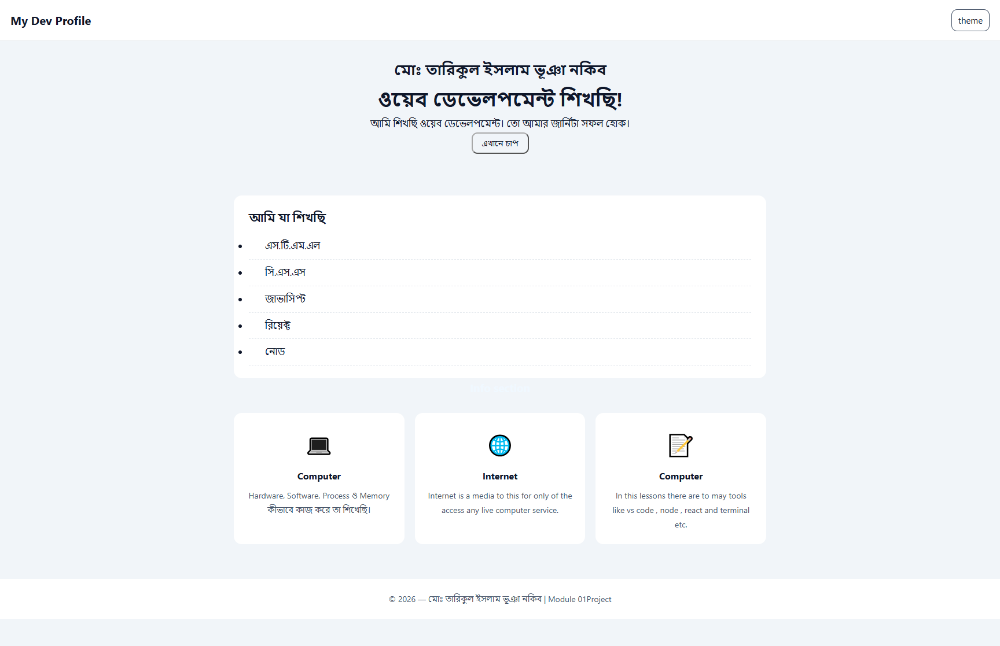
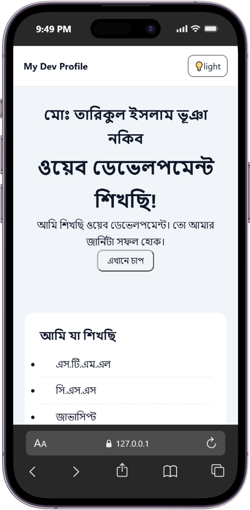
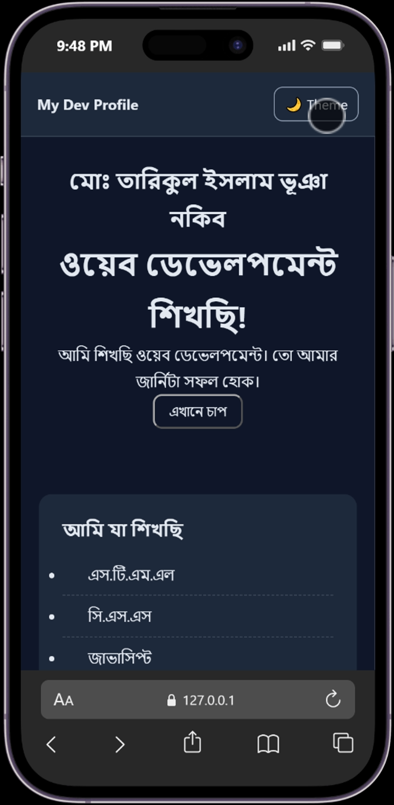

# 👨‍💻 My Dev Profile — Module 01 Project

Module 01 (Computer & Web Fundamentals) শেষে তৈরি আমার প্রথম ওয়েব পেজ।

## 🔗 Live Demo
https://mdnakib-me.github.io/my-first-site/

## 📸 Screenshot




## ✨ Features
- Responsive লেআউট (Mobile, Tablet, Desktop)
- Dark / Light Theme টগল (localStorage-এ সংরক্ষিত)
- সময় অনুযায়ী বাংলা অভিবাদন
- Footer-এ স্বয়ংক্রিয় সাল
- Console সম্পূর্ণ Error-মুক্ত

## 🛠️ Tech Stack
- HTML5
- CSS3 (Flexbox, Grid, CSS Variables, Media Query)
- Vanilla JavaScript (DOM, Events, localStorage)

## 📁 Folder Structure
```
my-first-site/
├── index.html
├── README.md
├── .gitignore
├── css/
│   └── style.css
├── assets/image
│   └── mobile_light.png
│   └── mobile_dark.png
├── js/
│   └── main.js
└── images/
```

## 🚀 কীভাবে চালাবেন (Local)
```bash
git clone https://github.com/mdnakib-me/my-first-site.git
cd my-first-site
code .
```
এরপর VS Code-এ **Live Server** extension দিয়ে `index.html` চালান
অথবা সরাসরি ব্রাউজারে ফাইলটি খুলুন।

## 📚 এই প্রজেক্টে যা শিখেছি
- Folder Structure ও Relative Path
- HTML কাঠামো, CSS Layout ও JS Event
- Git, GitHub ও GitHub Pages-এ Deployment
- Browser DevTools দিয়ে Debugging

## 👤 Author
**Md. Tarikul Islam Bhuyian Nakib** — [GitHub](https://github.com/mdnakib-me)
